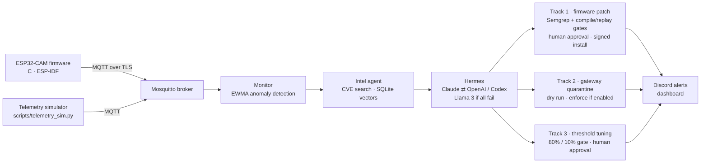

# AES — Autonomous Edge-Sentinel

[](https://github.com/nguyennnssson/aes/actions/workflows/python-tests.yml)
[](https://github.com/nguyennnssson/aes/actions/workflows/esp32-build.yml)

AES watches IoT cameras for coordinated telemetry anomalies and asks an LLM to
classify each incident against public vulnerability data. It then prepares a
fix: a firmware patch, a network quarantine, or a tuned detector. Firmware
patches and detector changes wait for human approval. Quarantine of
closed-firmware cameras can run automatically once an operator enables it.

AES started as a team project at the ClawComp hackathon and was developed
further afterwards. It is a prototype that fails closed: missing hardware,
skipped gates, low confidence, or a pending approval all keep an incident open.

## How it works



- **Detect:** each device keeps an EWMA baseline for CPU, memory, packet rate
  and connections. By default, an anomaly needs at least 2 metrics at least 50%
  above it.
- **Classify:** the Intel agent retrieves matching CVEs, and Hermes returns a
  JSON verdict. The action is allowlisted per device, and confidence below 0.5
  goes to manual review.
- **Respond:** the device's track decides the fix, and every step is logged to a
  tamper-evident incident log.

Details: [architecture](docs/architecture.md).

## Status

| | |
|---|---|
| **Tested on hardware** | ESP32-CAM firmware built with ESP-IDF 5.2.7 and flashed to an ESP32-D0WD-V3 board; its live telemetry streamed into the pipeline over a USB-serial bridge. |
| **Simulated** | Attack scenarios (`scripts/telemetry_sim.py`). The Tapo C200 quarantine path has run only as a dry run. |
| **Not yet done** | A Gate 2 run on a reference board and an end-to-end remediation install. |
| **Demo data** | `scripts/live_demo.py` and the web UI's demo mode show sample numbers (e.g. an 80→95% detection curve), labelled "PROTOTYPE · SAMPLE DATA". They are not measurements. |

Known limitations: Gate 1's Semgrep parser rejects the demo file
`esp32-cam/main/main_vulnerable.c` (the production `main.c` scans cleanly), and
closed-firmware cameras have no telemetry collector in this repo.

## Model routing

| Job | Default chain |
|---|---|
| Classify incidents, plan the response, tune thresholds | Claude → OpenAI / Codex |
| Write firmware patches | OpenAI / Codex → Claude |
| Every backend in the chain failed | local Llama 3 8B (Ollama), always held for manual review |

Claude runs through the Anthropic API or the Claude Code CLI, and OpenAI models
through the OpenAI API or the Codex CLI. Both chains are configurable. A
failing backend hands the request to the next one, and every verdict records
which model produced it. "Hermes" and
"OpenClaw" are this project's names for its reasoning and execution layers, not
the external frameworks of the same names.

Details: [models and fallback](docs/models.md) · [vulnerability index](docs/intel-index.md).

## Self-tuning detector

After an incident, Hermes proposes new detection thresholds. The sandbox replays
operator-signed attack and normal samples through the live detection function.
A proposal must catch at least 80% of attacks with at most 10% false positives.
A human then approves it by CLI or dashboard, and the approval is HMAC-signed.

Details and the reproduce command: [tuning gate](docs/tuning-gate.md).

## Quickstart (development)

```bash
python -m venv .venv && source .venv/bin/activate   # Windows: .venv\Scripts\activate
pip install -r requirements.lock
cp .env.example .env                                 # choose Claude / Codex backends

python scripts/check_backends.py                     # one live prompt per model
pytest tests -q

# Local demo against a Mosquitto broker on localhost:1883 (development only)
export AES_INSECURE_DEV_MQTT=1 MQTT_PORT=1883
python -m agents.monitor_agent_mqtt                         # terminal 1
python scripts/telemetry_sim.py --attack esp32-cam-01       # terminal 2
```

Gateway, firmware provisioning, approvals and production settings:
[install, configure, and deploy](docs/deployment.md).

## Repository map

```text
agents/        monitor, Intel retrieval, Hermes, model backends, response state machine
dashboard/     token-protected FastAPI API and local console
discord/       #aes-alerts webhook posts
docs/          architecture, models, index, tuning gate, deployment
esp32-cam/     ESP-IDF firmware (C): telemetry, TLS MQTT, dual OTA partitions + rollback
gates/         Gate 1 (Semgrep rules) and Gate 2 (compile / boot / replay)
openclaw/      gateway quarantine backends (iptables, pf, netsh)
rag/           vulnerability ingestion and the SQLite vector index
raspberry-pi/  TLS Mosquitto / access point / receiver provisioning
scripts/       simulator, backend check, labelling, demo, test runners
skills/        detector-tuning sandbox, signed approval, injection
web/           Next.js operator UI
tests/         unit and boundary tests
```

## Team

Team roles at ClawComp:

- Son Nguyen — AI infrastructure: Hermes, model backends, RAG, learning loop, monitor, docs.
- Duc Vu — software and pipeline: OpenClaw gateway quarantine and response routing.
- Vy Tuong Khong — firmware: the ESP32-CAM dual-OTA firmware and the Gate 1 / Gate 2 harnesses.

## License

MIT — © 2026 Son Nguyen and AES contributors.
